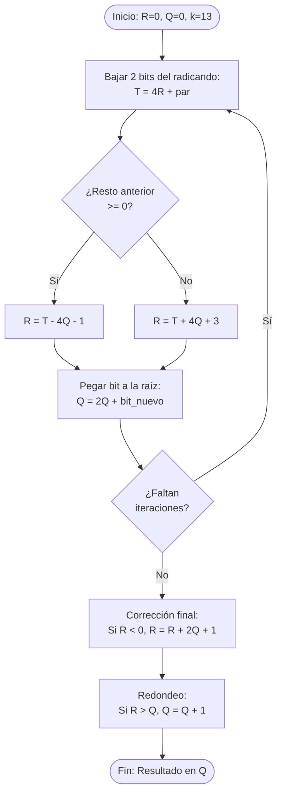
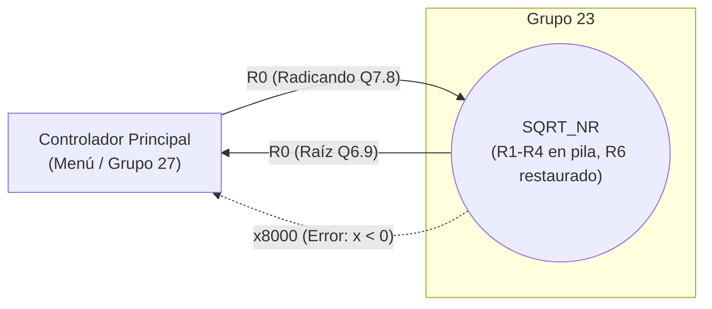

# Grupo 23 · SQRT

**Consigna:** Non-Restoring

## Integrantes
- De Los Santos, Dahiara Claribel (@dahizz)
- Kamchem, Melina (@melika2332)
- Wereszczuk, Danna Maira (@wereszczukdanna-cell)

## Lab 3c · LOVELACE (simulador funcional)

**LOVELACE** es la ISA de 16 bits del grupo; su nombre es un homenaje a Ada Lovelace. Todo lo del Lab 3c está en
[`lab3c/`](lab3c/), con su instructivo en [`lab3c/README.md`](lab3c/README.md):

- `lab3c/simulador/`: simulador funcional (`simulador.py`), interfaz gráfica (`interfaz.py`) y ensamblador.
- `lab3c/benchmark/`: el benchmark ya ensamblado (`.hex`, `.bin`) y los `.asm` con que se ensambla.
- `lab3c/ejemplos/`: la calculadora por teclado y un programa de prueba de teclado.

| | LC-3 | LOVELACE |
|---|---:|---:|
| Instrucciones del programa | 357 505 | **17 905** (19,97× menos) |
| Instrucciones con el sistema operativo | 379 579 | **28 855** (13,15× menos) |
| Memoria del programa | 15 792 B | **11 980 B** |

La salida del benchmark es idéntica a la de la LC-3 en las 23 operaciones. Ejecutar, desde `grupo23/lab3c/`:

```
python simulador/simulador.py benchmark/benchmark_g23.hex
python simulador/interfaz.py
```

## Archivos
- `alto_nivel/lab3a.cpp`: Programa en C++ con la demostración de conversión a formato Q, compatibilización de formatos (Q3.12 y Q7.8) y operaciones de suma, resta, producto y división.
- `asm/lab3a.asm`: Implementación en assembly LC-3 de las conversiones de formato, la suma, la resta y la multiplicación en punto fijo, utilizando subrutinas de corrimiento (`SHL32`), control de rango (`RANGO12`) y multiplicación por desplazamiento y suma (`MULS`).
- `alto_nivel/sqrt_nr.cpp`: Análisis en C++ de la raíz cuadrada non-restoring, con tres modos de uso:
  - `traza <x> <n> <k>`: muestra cada iteración para un valor (por ejemplo, `traza 12 8 13`).
  - `analisis`: recorre las 32 768 entradas positivas de cada formato y mide error, rango y valores intermedios.
  - `verificar`: compara un modelo del módulo en assembly con la versión en C++ para las 65 536 entradas y cuenta las instrucciones LC-3 ejecutadas.
- `asm/modulo_sqrt_nr.asm`: Subrutina `SQRT_NR` en assembly LC-3, diseñada como caja negra que sigue la convención de llamada de la plataforma (resguardo de registros en la pila con `R6`), lista para ser enlazada al menú principal.
- `bitacoras/bitacora_3a.md` y `bitacoras/bitacora_sqrt_nr.md`: Registros diarios de las sesiones de trabajo y optimización.
- `informes/`: Informes de laboratorio en PDF.

## Documentación Técnica (Lab 3b - SQRT Non-Restoring)
- **Algoritmo:** Raíz cuadrada "non-restoring" dígito a dígito (Li y Chu, 1996). Obtiene un bit de la raíz por iteración usando solo sumas, restas en complemento a 2 y corrimientos (`ADD` de un registro consigo mismo).
- **Ubicación en Memoria:** La define el enlazador de `lc3.lgrum.xyz`, que ubica cada módulo a continuación del programa de entrada (el `.ORIG` de un módulo se ignora, por eso el archivo no lo incluye). Por ejemplo, en la prueba de integración con el benchmark completo de la calculadora (7945 palabras) el módulo quedó en `x4A8F`–`x4AC8`.
- **Publicación:** el módulo está publicado en la plataforma como `modulo_sqrt_nr`, versión v2 (15/11/2026), idéntica a `asm/modulo_sqrt_nr.asm`. La v1 (10/11/2026) guardaba los registros con `ST`/`LD` en zonas `.BLKW`.
- **Integración y Compatibilidad:** Diseño encapsulado en "caja negra", compatible con el menú de la calculadora del Grupo 27 (opción `[4] sqrt` → `[0] NON RESTORING`, controlador `main_menu_one_q8_result_q9`). Se importa como `.EXTERNAL G23_MODULO_SQRT_NR-SQRT_NR` y se llama con `.FILL` + `JSRR`.
- **Convención de llamada:**
  - `R0`: radicando (Q7.8) a la entrada y raíz (Q6.9) a la salida.
  - `R1` a `R4`: se apilan con `STR` sobre `R6` al entrar y se desapilan con `LDR` antes de `RET`.
  - `R5` y `R7`: no se modifican (la subrutina no llama a otras subrutinas).
  - `R6` (pila): vuelve con el mismo valor que tenía al entrar.
  - Si la entrada es negativa, devuelve `x8000` sin tocar la pila.
- **Iteraciones (k):** 13 fijas, inicializadas de forma interna. Es el máximo con el que el resto parcial y el término `4Q + 3` entran en 16 bits con signo (máximo valor intermedio: 23 172). Con k = 14 llegarían a 46 343 y desbordarían.

## Cómo probarlo
**Para Lab 3a:**
1. Cargar el archivo `asm/lab3a.asm` en el simulador de la LC-3 (`lc3.lgrum.xyz`) y ensamblarlo.
2. Poner un breakpoint en `ST R1, X_Q8` para verificar el corrimiento aritmético a la derecha (`R1 = x01B3`).
3. Poner un breakpoint en `M_SIG` dentro de la subrutina `MULS` para observar cómo crece el producto parcial en los registros R1 y R2.
4. Ejecutar y revisar los valores guardados en memoria (ej. `PROD_HI:PROD_LO` debe dar `xFFC2:xCD40` y `PROD_Q8` debe dar `xFC2C`).

**Para Lab 3b (SQRT Non-Restoring):**

*Prueba aislada del módulo (sin iniciar sesión):*
1. En `lc3.lgrum.xyz`, crear el archivo `modulo_sqrt_nr.asm` con el contenido de `asm/modulo_sqrt_nr.asm`.
2. Crear un `main.asm` propio, marcarlo como archivo de entrada ("Usar como entrada") y llamar a la subrutina:
   ```asm
           .ORIG x3000
           .EXTERNAL MODULO_SQRT_NR-SQRT_NR
           LD   R0, X          ; radicando en Q7.8
           LD   R5, PTR_SQRT
           JSRR R5             ; R0 = raiz en Q6.9
           HALT
   X        .FILL x0C00        ; 12.0
   PTR_SQRT .FILL MODULO_SQRT_NR-SQRT_NR
           .END
   ```
3. Ensamblar, revisar la pestaña "Mapa de enlace" y poner breakpoints en `SQ_RED` (antes del redondeo) y en la instrucción posterior a `JSRR` para comprobar el resultado (`R0 = x06EE` para 12) y que `R1`–`R6` vuelvan con su valor original.

*Prueba integrada con la calculadora (requiere iniciar sesión con la cuenta del grupo):*
1. Iniciar sesión en `lc3.lgrum.xyz` y usar como entrada un programa basado en el `g27_main` del Grupo 27, que llama a `G27_MAIN_MENU_PROGRESO-MAIN_MENU`. Al ensamblar, el enlazador descarga los módulos publicados de todos los grupos.
2. En la consola interactiva, seleccionar `[4] sqrt` → `[0] NON RESTORING` e ingresar un valor decimal (o usar el modo automático del menú con la operación de índice 8).
3. Verificar en la consola la impresión del resultado Q6.9 traducido a decimal.

## Especificaciones para Verificación (Punto Fijo, Rangos y Precisión)

| Parámetro | Especificación Adoptada | Justificación Técnica |
| :--- | :--- | :--- |
| **Formato de Entrada** | **Q7.8** | Formato acordado con los Grupos 9 y 27. El radicando ocupa la parte alta de un radicando de 26 bits (`D = X << 10`), sin instrucciones extra. |
| **Formato de Salida** | **Q6.9** | Calculado con la fórmula $f = n/2 + k - 8 = 9$ bits fraccionarios. |
| **Rango de Entrada** | **[0 ; 127.996]** | Si la entrada es negativa, la rutina devuelve `x8000` indicando error al sistema central. |
| **Rango de Salida** | **[0 ; 11.3145]** | $\sqrt{127.996} = 11.3135$, que redondeado en Q6.9 da `x16A1` = 11.314453. |
| **Resolución (1 LSB)** | **0.00195** | $2^{-9}$: salida con 9 bits fraccionarios. |
| **Error Máximo** | **0.00098 (½ LSB)** | Redondeo al más cercano en el último paso (si R > Q, Q = Q + 1). Sin redondeo el error máximo sería 1 LSB. |
| **Error Medio** | **0.00049 (≈ ¼ LSB)** | Medido sobre las 32 768 entradas positivas. |
| **Raíces Exactas** | **182 entradas** | Error 0 en los cuadrados perfectos representables (1, 4, 16, 25, 64, 100, ...). |

## Casos Probados en el Simulador (Validación Empírica)
Resultados verificados en `lc3.lgrum.xyz`: con un programa de prueba propio y, para 12, 25, 2, 100 y -5, a través del menú de la calculadora del Grupo 27. Todos coinciden con la versión en C++:

| Radicando Decimal | Entrada Hex (Q7.8) | Raíz Decimal | Salida Hex (Q6.9) | Observación |
| :--- | :--- | :--- | :--- | :--- |
| `12.00` | `x0C00` | `3.46484375` | `x06EE` | Caso base sin raíz exacta. |
| `25.00` | `x1900` | `5.00` | `x0A00` | Raíz exacta entera. |
| `2.00` | `x0200` | `1.4140625` | `x02D4` | Raíz irracional (√2 = 1.41421). |
| `100.00` | `x6400` | `10.00` | `x1400` | Raíz exacta entera. |
| `127.996` | `x7FFF` | `11.314453` | `x16A1` | Límite superior de Q7.8. |
| `0.0039` | `x0001` | `0.0625` | `x0020` | Mínimo positivo de Q7.8. |
| `0.00` | `x0000` | `0.00` | `x0000` | Validación del límite inferior. |
| `-5.00` | `xFB00` | `NaN (imprime -64)` | `x8000` | Rechazo correcto de radicando negativo (el menú imprime -64 al interpretar el error `x8000` en Q6.9). |

La equivalencia entre el assembly y la versión en C++ se comprobó además para las 65 536 entradas posibles con el modo `verificar` de `sqrt_nr.cpp` (0 diferencias).

## Arquitectura y Métricas de Desempeño (Benchmark)
Métricas medidas en el simulador `lc3.lgrum.xyz` (contador de instrucciones y mapa de enlace) y extendidas a todas las entradas con el modo `verificar`:

| Métrica | Valor Alcanzado | Observación |
| :--- | :--- | :--- |
| **Uso de Memoria** | 58 palabras | 57 instrucciones + 1 constante (`x8000`), sin tablas LUT. |
| **Complejidad Temporal** | 277 a 335 instrucciones (promedio 307.5) | Para entradas ≥ 0, incluido el `RET`. Ejecución acotada por $k=13$ iteraciones fijas (determinista). Entrada negativa: 4 instrucciones. |
| **Costo por Iteración** | 19 a 25 instrucciones | La mayor parte se usa en bajar los bits del radicando y en negar el sustraendo, operaciones que la LC-3 no tiene. |
| **Optimización ISA** | 0 Multiplicaciones / 0 Divisiones | Solo requiere sumas, complemento a 2 y saltos por bit de signo. |
| **Resguardo de Registros** | Pila (`R6`) | Sigue la convención de la plataforma: apila R1 a R4 con `STR` y los restaura con `LDR`. |

## Diagrama de Flujo: Lazo Principal SQRT Non-Restoring



## Integración de la Interfaz (Black-Box)

